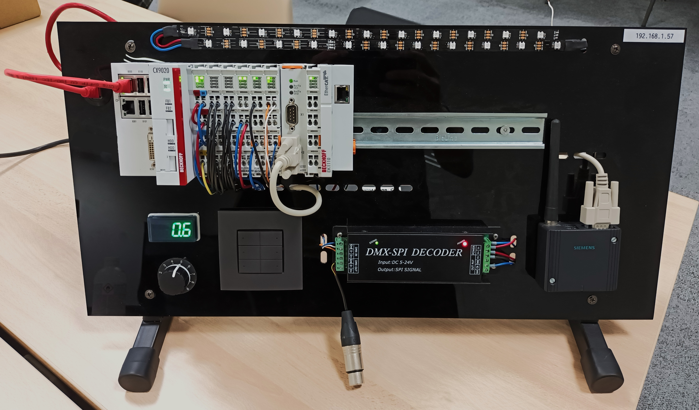

## The setup

DMX is a standard for digital communication networks that are commonly used to control lighting and effects. It can be used to control almost anything, reflecting its popularity in all types of venues. Because DMX does not include automatic error checking and correction, it is therefore not an appropriate control for hazardous applications, such as pyrotechnics or movement of theatrical rigging. However, it is still used for such applications. False triggering may be caused by electromagnetic interference, static electricity discharges, improper cable termination, excessively long cables, or poor quality cables.

At the datalink layer, a DMX512 controller transmits asynchronous serial data at 250 kbit/s. The data format is fixed at one start bit, eight data bits (least significant first), two stop bits and no parity.

> BeckHoff Application Film: [Partnership with PIXERA for media and building automation](https://www.youtube.com/watch?v=Y5K_fA3BEpw)

## Hardware

- DMX controller: DMX-SPI Decoder DMX200
  - LED strip: 12V WS2811 LED Strip (20 leds of the 5050 kind)

- *GSM module: Siemens TC35 for SMS and call (not used)*
- DMX Moving Head: Fun Generation PicoSpot 20 LED
- PLC terminal: 
  - EL6851 DMX master terminal
  - *EL6002 RS232 serial communication terminal (not used)*

## Preperations

- Lees de [documentatie van de LED driver](./resources/DMX200.pdf).
- Raadpleeg de handleiding van de Beckhoff [EL6851 DMX Master](https://download.beckhoff.com/download/Document/io/ethercat-terminals/el6851en.pdf). Lees zeker de pagina's:
    - Product overview => Introduction
    - Product overview => Technical data 
    - Mounting and wiring => LEDs and connection
    - Commissioning => Basic function principles
- Lees volgende pagina's over de DMX bibliotheek [Tc2_DMX](https://infosys.beckhoff.com/english.php?content=../content/1033/tcplclib_tc2_dmx/index.html&id=3663748578736491244)
    - Introduction
    - DMX
    - Programming => Function blocks => Low Level => Base => FB_EL6851CommunicationEx
    - Programming => DUTs => Structures => ST_EL6851InData, ST_EL6851OutData en ST_DMXCommandBuffer
    - Appendix => Example: DMX master

## Goals

1.  Leg in je eigen woorden DMX uit. Hoe is het opgebouwd en wat kan je ermee?
2.  Beschrijf de aansluitingen van de EL6851.
3.  Beschrijf de 'FB_EL6851CommunicationEx' functieblok. Welke zijn de in- en uitgangen en waarvoor wordt deze gebruikt?
4.  Beschrijf de 'ST_EL6851InData' structure. Wat is de inhoud en waarvoor wordt deze gebruikt?
5.  Beschrijf de 'ST_EL6851OutData' structure. Wat is de inhoud en waarvoor wordt deze gebruikt?
6.  Beschrijf de 'ST_DMXCommandBuffer' structure. Wat is de inhoud en waarvoor wordt deze gebruikt?
7.  Beschrijf de aansluitingen en de werking van de DMX LED-strip controller.
8.  Beschrijf de aansluitingen en de werking van de DMX200.

## Exercises

Programmeer de PLC zodat de ganse RGB LED-strip te besturen is vanuit een visualisatie. Voor DMX te programmeren dien je de bibliotheek Tc2_DMX toe te voegen bij je References.

### Programmatie (minimaal vereist om 60% te behalen)

#### 1. Communicatie setup (5%)

Maak gebruik van de 'FB_EL6851CommunicationEx' functieblok voor de communicatie met de EL6851. Koppel de juiste variabelen met de EL6851. Laat de status van deze functieblok zien in de visualisatie voor snelle foutopsporing (error codes, ready status, etc.).

#### 2. Basis DMX controle (10%)

Gebruik de array "arrProcessData" van de FB_EL6851CommunicationEx om data op de DMX bus te zetten. Zorg ervoor dat de DMX LED-strip controller vanuit de visualisatie te bedienen is.

**Visualisatie:** Minimaal RGB sliders om handmatig kleuren in te stellen op een paar LEDs.

> [!Tip]
>
> Elke LED heeft waarschijnlijk meerdere kanalen (R, G, B)

#### 3. Motor status display (20%)

Gebruik de DMX LED-strip controller om een status van een 'motor' weer te geven, die selecteerbaar is via een combo box (enumerator + text list) in de visualisatie:
- **NOT READY:** alle blauwe LEDs knipperen met 1 Hz (aan 500ms, uit 500ms)
- **READY:** alle blauwe LEDs aan (constant)
- **MOVING:** alle groene LEDs knipperen met 2 Hz (aan 250ms, uit 250ms)
- **LOW SPEED:** alle groene LEDs aan (constant)
- **EMERGENCY:** alle rode LEDs knipperen snel met 4 Hz (aan 125ms, uit 125ms)

> [!Tip]
>
> Gebruik een ENUM type voor de motor states en een text list voor de combo box in de visualisatie

#### 4. Looplicht met configuratie (25%)

Programmeer een configureerbaar looplicht met de DMX200 driver:

**Basis functionaliteit:**

- Eén LED die over de strip beweegt van links naar rechts, en vervolgens rechts naar links (herhaaldelijk)
- Kies zelf een kleur (maak dit instelbaar)
- Start/Stop via druktoets in visualisatie

**Configuratie via visualisatie:**

- Snelheid instelbaar via potentiometer (toon waarde op EL400x display)
  - Snelheid = tijd tussen stappen (bv. 50ms - 1000ms)
- Kleur van het looplicht instelbaar met 3 knoppen
- Lengte van de "staart" instelbaar via slider (1-5 LEDs)

---

### Bijkomende programmatie (Percentage telt enkel indien minimale programmatie bereikt is)

#### 6. Shooting light effect (20%)

Programmeer een dynamisch shooting light effect:

**Functionaliteit:**

- 6 druktoetsen in visualisatie:
  - 3 knoppen voor Rood, Groen, Blauw van **links naar rechts**
  - 3 knoppen voor Rood, Groen, Blauw van **rechts naar links**
- Bij indrukken "schiet" een gekleurde LED over de strip
- De LED verplaatst zich met instelbare snelheid
- LED verlaat de strip (komt niet terug zoals bij looplicht)
- **Meerdere "shots" kunnen tegelijk actief zijn**
  - Als je 3x snel op rood drukt, moeten er 3 rode LEDs achter elkaar schieten
- Collision detection: wat gebeurt er als twee shots elkaar tegenkomen? Laat je verschillende kleuren elkaar passeren/blenden, stoppen de shots met bestaan of stopt ga je voor een ontploffingseffect!

**Visualisatie:**

- 6 duidelijke knoppen
- Snelheid instelbaar
- Teller per kleur: hoeveel shots zijn afgevuurd

#### 7. Geavanceerd statistiek-systeem met CSV logging (20%)

Stuur de PicoSpot Moving Head aan. Gebruik alle mogelijke channels en zorg dat ze allen volledig te besturen zijn vanuit de visualisatie.

---

## Questions

For questions and support please place a comment in the pull request titled **Feedback**.

## Remarks

Take care of the setup. Afterwards return the setup to its original state and place it on top of the lab table in the same place. If you notice a defect, you must immediately inform the teacher.
